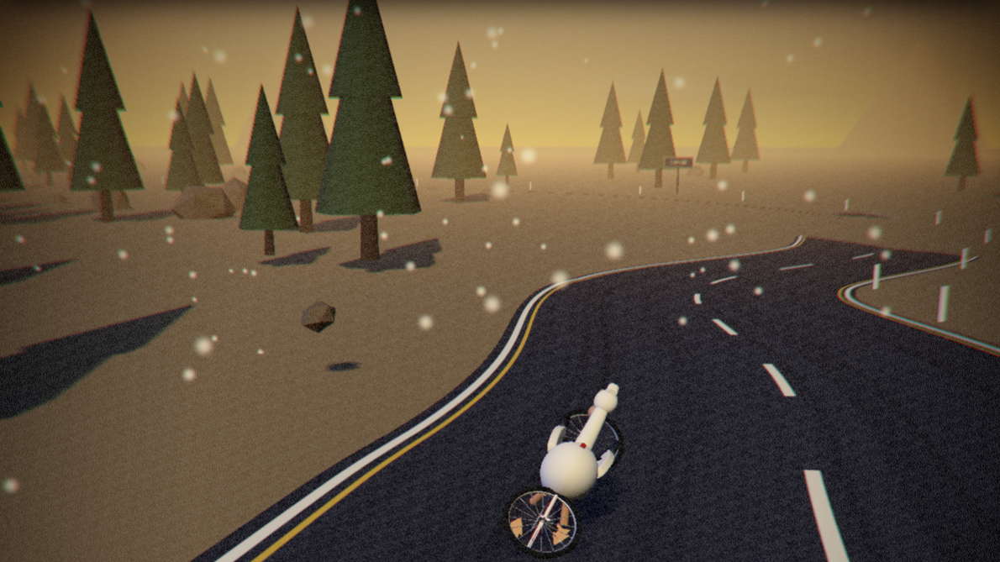

# PELICAN · RIDE / 鹈鹕公路（MiniMax M3.1 Flash 版）

**在线试玩：** <https://avaterxxx.github.io/pelican-ride-3d-minimaxM3.1-flash/>
**GitHub 仓库：** <https://github.com/AvaterXXX/pelican-ride-3d-minimaxM3.1-flash>

[](https://avaterxxx.github.io/pelican-ride-3d-minimaxM3.1-flash/)

一个**单文件、可离线运行**的 Three.js 3D 互动网页：鹈鹕骑自行车沿公路疾驰，
按下「骑车出发」后它会自己跳下车、走到停在路边的跑车旁、拉开车门坐进驾驶位开始飙车。
支持可移动电影镜头、自动驾驶 / 人工接管、四套完整场景世界与昼夜调节。

**100% built with MiniMax M3.1 Flash · 约 3 小时 · 全程 0 外部美术素材**

> 本仓库是同题材作品 [pelican-ride-3d](https://github.com/AvaterXXX/pelican-ride-3d)（DeepSeek 版本）的
> **MiniMax M3.1 Flash 重制版**：模型、场景、音效全部由代码程序化生成，不含任何外部贴图或模型文件。

---

## 构建信息

- **构建模型**：MiniMax M3.1 Flash
- **构建耗时**：约 3 小时（含建模、动作系统、镜头调度、实测与修复）
- **外部依赖**：仅 `three`（构建期打包进单文件），运行时零依赖

---

## 亮点

| 能力 | 说明 |
| --- | --- |
| 换车过场 | 11 秒一镜到底的脚本镜头：刹停 → 跳下自行车 → 走向跑车 → 开车门 → 跳上驾驶座 → 关门点火 → 并线起步 |
| 鹈鹕骨架 | 两骨 IK 让脚精确踩在曲柄上，翅膀反向 IK 抓住车把 / 方向盘，脖子是可混合的 S 曲线，围巾随风飘动 |
| 场景世界 | 黄金海岸 / 霓虹雨夜 / 雷暴荒野 / 沙漠黄昏，各自独立的天空、地形、道具、粒子与天气 |
| 镜头系统 | 电影跟拍 / 环绕 / 骑手视角 / 低机位 / 航拍；车内：副驾过肩 / 驾驶员第一人称 / 引擎盖 / 车轮 |
| 手动驾驶 | `WASD` 油门刹车转向，`Space` 手刹漂移，`V` 随时在自动 ⇄ 人工之间接管 |
| 电影化管线 | ACES 调色、泛光、teal-orange 电影色、镜头色散、径向速度模糊、胶片颗粒、2.39:1 遮幅、片头标题卡、机身震动 |
| 程序化音效 | 引擎、风噪、链条、喇叭、车铃、撞击、过场 whoosh，全部 WebAudio 实时合成 |

---

## 文件结构

```text
pelican-ride-3d-minimaxM3.1-flash/
├─ index.html         ← 部署用成品：整个游戏压进一个文件（644 KB）
├─ source/            ← 可编辑源码
│  ├─ src/
│  │  ├─ main.js      主循环、状态机、过场调度、驾驶系统
│  │  ├─ world.js     场景世界：赛道、地形、道具、粒子、天气
│  │  ├─ sky.js       程序化天空（渐变 / 太阳 / FBM 云 / 星空）
│  │  ├─ pelican.js   鹈鹕模型 + 骨架 + 姿势混合 + 两骨 IK
│  │  ├─ bicycle.js   自行车模型 + 传动 / 转向 / 脚撑
│  │  ├─ car.js       跑车模型 + 敞篷座舱 + 可开启车门 + 内饰
│  │  ├─ camera.js    多机位导演系统
│  │  ├─ postfx.js    后期处理链
│  │  ├─ audio.js     WebAudio 程序化音效
│  │  ├─ ui.js        HUD / 速度表 / 控制面板
│  │  ├─ util.js      数学、缓动、噪声、IK、建模辅助
│  │  └─ style.css    电影化 UI 样式
│  ├─ tools/inline.mjs  单文件打包脚本
│  ├─ package.json
│  ├─ package-lock.json
│  └─ vite.config.js
├─ preview.png
├─ .gitignore
└─ README.md
```

- **本地打开**：双击 `index.html` 即可，不需要服务器。
- **发布**：GitHub Pages 直接从仓库根目录发布（Pages → Source: `main` / `/`）。
- **重新构建**：

```powershell
cd source
npm install          # 首次使用或 node_modules 丢失时
npm run build        # 产出单文件 ../index.html
```

---

## 操作

| 按键 / 操作 | 功能 |
| --- | --- |
| 鼠标拖拽 / 滚轮 | 移动、缩放镜头（任何机位下都可用） |
| `C` | 循环切换机位 |
| `W` `A` `S` `D` / 方向键 | 油门 / 刹车 / 转向 |
| `Space` | 手刹漂移 |
| `V` | 自动驾驶 ⇄ 人工接管 |
| `L` | 车灯 |
| `H` | 喇叭 |
| `P` | 调试信息面板 |

界面右下角的「导演控制台」可实时调整场景、时刻、雾、颗粒、辉光、车速、倾角、油门、
灵敏度与焦距；底部「自行车动作」可切换巡航 / 冲刺 / 爬坡 / 跳台腾空 / 翘头 / 后空翻 /
蛇行 / 急刹 / 静止。

---

## URL 深链参数

| 参数 | 说明 |
| --- | --- |
| `?auto=1` | 自动开始放映 |
| `?ride=1` | 开始后自动触发「骑车出发」过场 |
| `?back=1` | 驾驶阶段自动反向演回自行车 |
| `?scene=coast\|neon\|storm\|desert` | 指定场景世界 |
| `?act=sprint` | 指定自行车动作 |
| `?cam=cockpit` | 指定机位 |
| `?drive=auto\|manual` | 指定驾驶模式 |
| `?hud=0` | 隐藏全部界面（纯净画面，适合录屏） |
| `?debug=1` | 显示调试信息面板 |

例：<https://avaterxxx.github.io/pelican-ride-3d-minimaxM3.1-flash/?auto=1&ride=1&scene=desert&cam=cockpit>
